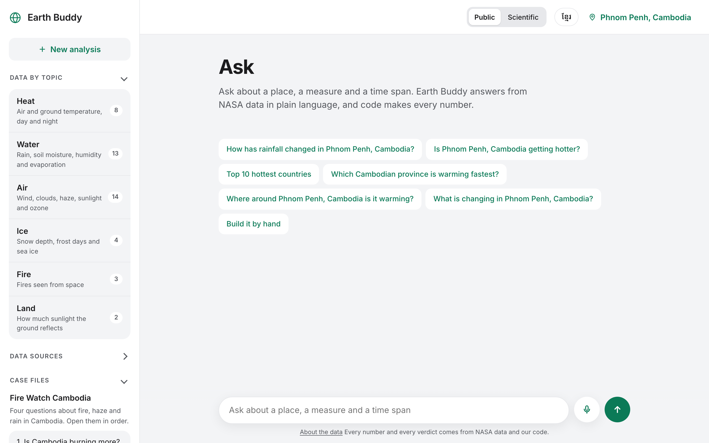
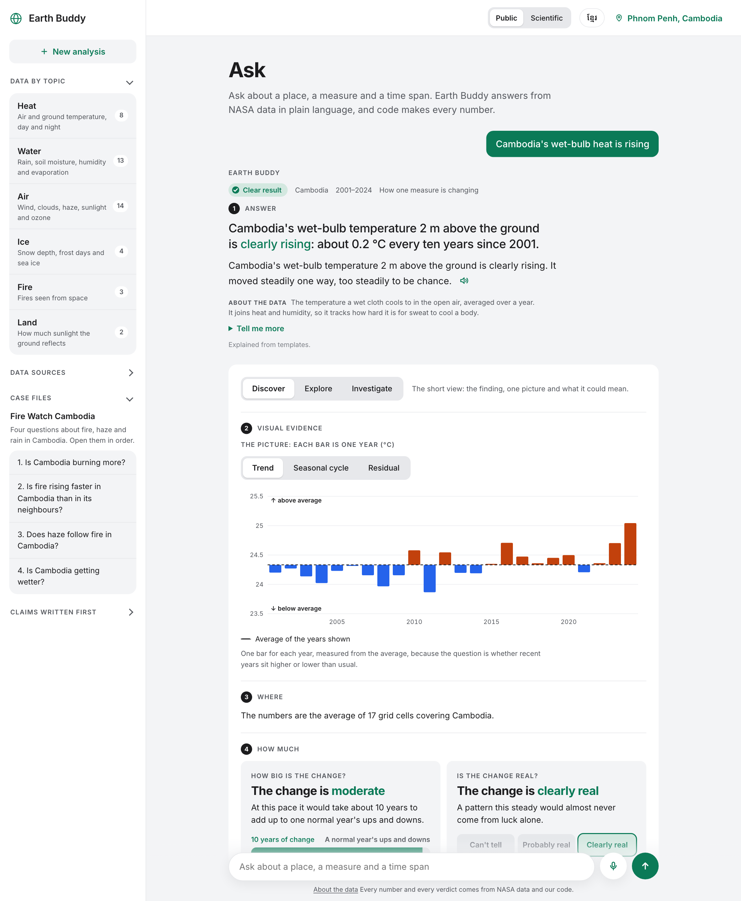
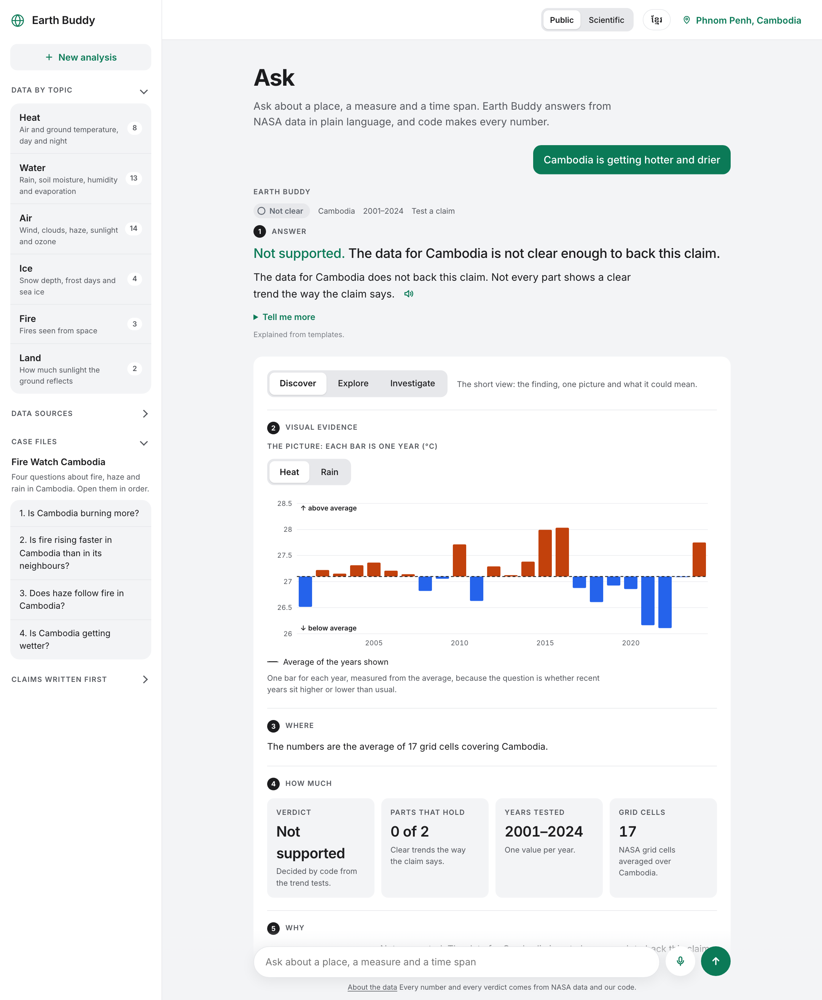
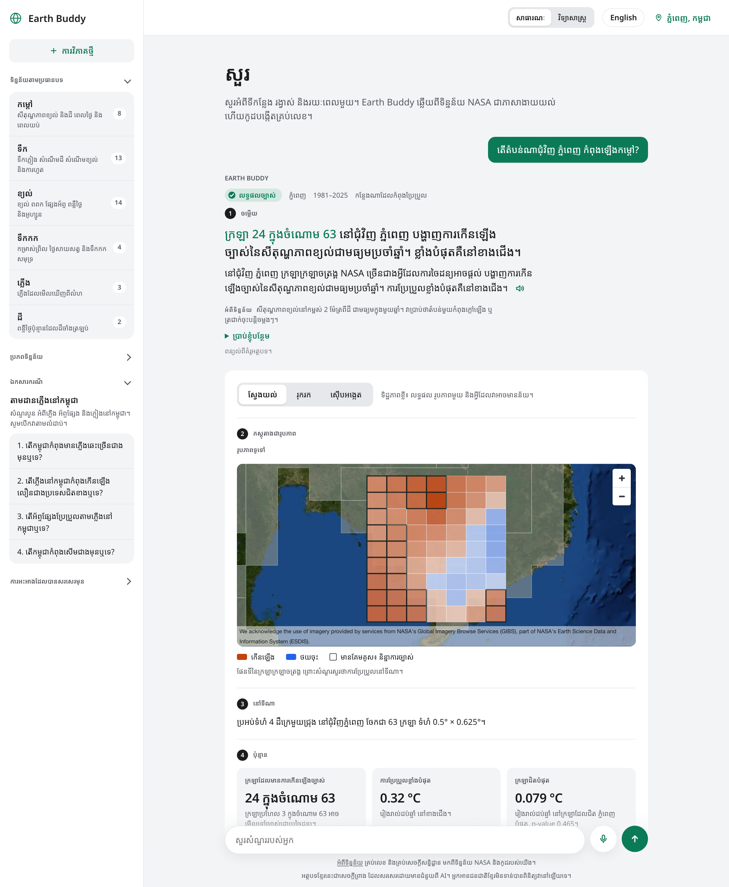

# Earth Buddy

Earth Buddy checks a sentence about how the Earth is changing at a place against NASA data. You type a claim, such as "Cambodia is getting hotter and drier", or a question, such as "Which Southeast Asian capital is warming fastest?". It returns a verdict, the numbers behind it, a chart, the method, and the NASA sources. When the data cannot tell, it says so.

Live: https://earth-buddy-analyst.vercel.app

Built for the NASA Space Apps Challenge 2026, Phnom Penh, challenge "Be An Earth System Trend Detective".

| Start | A clear trend | A claim the data does not back | Khmer, with the map |
|---|---|---|---|
|  |  |  |  |

Screens captured on 15 Nov 2026 from this code, running locally on real NASA data.

## The problem

People in Cambodia hear claims about the climate every week: it is hotter, the dry season is longer, the air is worse. NASA publishes the data that can test these claims. Testing one still means finding the right dataset, cutting it to a place, running a trend test, and knowing when 24 years is too short to say anything. Few people can do that, so a claim is repeated or dismissed without a check.

Earth Buddy does that check in one step and shows its work. It is built for Cambodian students, teachers, journalists, and local officers. It works in English and Khmer, by typing or by voice. This repository records no testing with these users.

## What it found

Each row is a sentence typed into the app. We ran every row again on 15 Nov 2026 from the data in this repository.

| Sentence | Answer | Numbers |
|---|---|---|
| "Cambodia's wet-bulb heat is rising" | Clear: rising | 0.2 °C per decade, 2001 to 2024. 95% range 0.056 to 0.38 °C. p 0.004. MERRA-2, 17 grid cells |
| "Nitrogen dioxide is rising in the Mekong Delta" | Clear: rising | 0.3 × 10¹⁵ molecules/cm² per decade, 2005 to 2024, on an average of 1.42. 95% range 0.22 to 0.38. p < 0.001. OMI/Aura |
| "Tonle Sap is getting less green" | Clear: falling | −0.014 NDVI per decade, 2001 to 2024, on an average of 0.579. 95% range −0.022 to −0.007. p 0.003. MODIS/Terra |
| "Cambodia is getting hotter and drier" | Not supported | Heat −0.13 °C per decade, 95% range −0.66 to 0.51 °C, p 0.623. Rain 14 % per decade, 95% range −41 to 95 %, p 0.437. 0 of 2 parts hold |
| "Which Southeast Asian capital is warming fastest?" | A leader, but not a clear one | Bandar Seri Begawan leads at 0.18 °C per decade, 1981 to 2025. 8 of the other 10 capitals are too close to tell apart |

Wet-bulb temperature joins heat and humidity. It tracks how hard it is for sweat to cool a body. So in this record Cambodia's air temperature shows no clear rise, while its wet-bulb temperature rises clearly.

"Not supported" does not mean the claim is false. It means this record, at this grid size, cannot tell.

## How it works

```
sentence ─► keyword reader ─► card (you can edit it) ─► typed Question
                                                            │
              NASA series: region file | live NASA POWER ◄──┤
                                                            ▼
                                  statistics ─► verdict, numbers, charts, sources
                                                            │
                                  explanation from templates ◄┘
```

1. **Sentence.** You type or speak a sentence in English or Khmer.
2. **Reader.** A keyword reader turns it into a typed question: a kind, a place, a measure, and a time span. No language model reads the sentence. If the reader cannot fill a field, a card opens and you fill it by hand.
3. **NASA series.** For a country or a named place, the app reads a yearly series built from NASA grids and stored in `data/v/`. For any other point on Earth, it asks NASA POWER live and caches the reply.
4. **Tests.** `earthbuddy/stats.py` runs the trend test, the change-point test, and the false-discovery check.
5. **Verdict.** Code picks the verdict and writes the headline from a fixed table of sentences. The screen shows the answer in nine sections, at three depths (Discover, Explore, Investigate), for two audiences (Public, Scientific). A share link reruns the same question.

The app answers eight kinds of question:

| Kind | Example |
|---|---|
| claim | "Cambodia is getting hotter and drier" |
| trend | "How is rain changing in Siem Reap?" |
| where | "Where around Phnom Penh is it warming?" |
| rank | "Which Southeast Asian capital is warming fastest?" |
| scan | "What is changing in the Mekong Delta?" |
| baseline | recent years against a reference period |
| extremes | record years and unusual years |
| relate | whether two measures move together |

The same code also answers in a Telegram chat, through `POST /api/telegram`, when a bot is configured (`docs/18-telegram.md`).

## Why trust it

**One rule: code makes every number and every verdict.** A language model never reads the sentence, never produces a value, and never picks a verdict. With AI switched off, every question still gets the same verdict, numbers, and charts.

**The statistics** (`docs/03-stats.md`). Every threshold lives in one place, `stats.T`, and a test fails if another file repeats one.

- The trend test is a two-sided Mann-Kendall test, corrected for year-to-year memory. A claim part that names its direction, such as "hotter", uses the one-sided p-value. The size of the change is a Sen slope with a 95% range. A slope t-test is shown next to it and never sets a verdict.
- "Clear" needs p < 0.05 and a 95% range that excludes zero. p < 0.10 reads "likely". Under 8 years the app refuses to compute. Under 10 years it says the record is too short.
- A Pettitt change-point test separates one jump from a steady trend, so a single shift is not reported as a trend.
- A test simulates 2,000 series with no trend and with year-to-year memory. It fails if more than 8% of them read as a clear trend.

**The false-discovery check.** Testing many things at once finds changes by luck. Claims with several parts, scans, rankings, and monthly trends go through a Benjamini-Hochberg check at 0.10. The Mekong Delta scan tests 44 measures. 12 have p < 0.05, and 9 pass the check and are reported as clear.

**Claims written first.** `data/audit.json` holds 8 claims written before their series were built, so nobody could pick claims that happen to pass. The answer to one of them was already known. 7 of the 8 come out "Not supported", and the app shows them in its sidebar. See "Claims written before the data" below.

**The Giovanni cross-check.** `data/giovanni/` holds area averages for Cambodia that we exported from NASA Giovanni, a separate NASA tool. `tests/test_giovanni.py` compares them with our Cambodia series over the 24 years. Both read the same NASA collections, so this checks our processing, not the measurements. Measured on 15 Nov 2026:

| Measure | Correlation | Trend per decade, Giovanni / ours | Trend level |
|---|---|---|---|
| heat | 0.985 | −0.012 / −0.13 °C | not clear in both |
| soil moisture | 0.994 | +2.7 / +3.2 % | not clear in both |
| rain (MERRA-2) | 0.990 | +185 / +219 mm/yr | not clear in both |
| rain (IMERG satellite) | 0.975 | +0.059 / +0.046 mm/day | not clear in both |

The years move together and the verdicts agree. The slopes differ, because Giovanni averages a box on the native grid and we average the country's 1° cells.

**The data rule.** Every measurement, border, place name, and map tile comes from NASA or a NASA partner, and each is one cited entry in `data/sources.json`. `tests/test_sources.py` fails on an unregistered source, and on any URL in the app that points outside the allowed hosts. The network code refuses to fetch data from a host that is not NASA's.

**Tests.** 473 tests pass with `pytest`. They need no network and no keys.

## NASA data

`data/catalog.json` lists 44 measures, 248 countries, and 43 named places.

| Measures | Count | Source |
|---|---|---|
| Heat, rain, humidity, wind, ozone, sea ice, air chemistry, and others | 24 | MERRA-2 reanalysis. PM2.5, dust, smoke, and carbon monoxide are downloaded from NASA Earthdata, and the rest are read through NASA POWER. Fire weather is GFWED, built on MERRA-2 |
| Soil moisture, evaporation, snow, runoff, drought | 7 | Land-surface models: MERRA-2 land and GLDAS |
| Sunlight, cloud, haze, albedo, UV | 6 | CERES SYN1deg satellite product, through NASA POWER |
| Rain from satellites | 1 | GPM IMERG, NASA and JAXA |
| Fires | 2 | MODIS and VIIRS active fires, NASA FIRMS |
| Greenness, nitrogen dioxide, sea temperature, groundwater | 4 | MODIS MOD13C2, OMI/Aura, MUR SST, GRACE and GRACE-FO |

Country borders come from the NASA SEDAC GPWv4 National Identifier Grid, which sets the country count at 248. Place names come from the SEDAC GPWv4 administrative unit centre points. Map imagery is NASA GIBS Blue Marble. The running app needs no login. Rebuilding the data needs a NASA Earthdata login. `docs/16-data-sources.md` has the full rule.

### References

`python tools/check_refs.py --markdown` prints this list from `data/sources.json`. `python tools/check_refs.py` resolved all 29 DOIs through doi.org on 15 Nov 2026. The other three entries are the acknowledgement texts that NASA POWER, GIBS, and Giovanni ask for.

- The data was obtained from National Aeronautics and Space Administration (NASA) Langley Research Center's Prediction Of Worldwide Energy Resources (POWER) project funded through the NASA Earth Science Division. https://power.larc.nasa.gov/
- Global Modeling and Assimilation Office (GMAO), & Pawson, S. (2015). MERRA-2 tavgM_2d_slv_Nx: 2d,Monthly mean,Time-Averaged,Single-Level,Assimilation,Single-Level Diagnostics V5.12.4 [Dataset]. Greenbelt, MD, USA: NASA Goddard Earth Sciences Data and Information Services Center (GES DISC). https://doi.org/10.5067/AP1B0BA5PD2K Read through NASA POWER.
- Global Modeling and Assimilation Office (GMAO), & Pawson, S. (2015). MERRA-2 tavgM_2d_flx_Nx: 2d,Monthly mean,Time-Averaged,Single-Level,Assimilation,Surface Flux Diagnostics V5.12.4 [Dataset]. Greenbelt, MD, USA: NASA Goddard Earth Sciences Data and Information Services Center (GES DISC). https://doi.org/10.5067/0JRLVL8YV2Y4 Read through NASA POWER.
- Global Modeling and Assimilation Office (GMAO), & Pawson, S. (2015). MERRA-2 tavgM_2d_lnd_Nx: 2d,Monthly mean,Time-Averaged,Single-Level,Assimilation,Land Surface Diagnostics V5.12.4 [Dataset]. Greenbelt, MD, USA: NASA Goddard Earth Sciences Data and Information Services Center (GES DISC). https://doi.org/10.5067/8S35XF81C28F Read through NASA POWER.
- Global Modeling and Assimilation Office (GMAO) (2015), MERRA-2 tavgM_2d_aer_Nx: 2d,Monthly mean,Time-averaged,Single-Level,Assimilation,Aerosol Diagnostics V5.12.4, Greenbelt, MD, USA, Goddard Earth Sciences Data and Information Services Center (GES DISC). https://doi.org/10.5067/FH9A0MLJPC7N
- Global Modeling and Assimilation Office (GMAO), & Pawson, S. (2015). MERRA-2 statD_2d_slv_Nx: 2d,Daily,Aggregated Statistics,Single-Level,Assimilation,Single-Level Diagnostics V5.12.4 [Dataset]. Greenbelt, MD, USA: NASA Goddard Earth Sciences Data and Information Services Center (GES DISC). https://doi.org/10.5067/9SC1VNTWGWV3 Read through NASA POWER.
- Gelaro, R., McCarty, W., Suárez, M. J., Todling, R., Molod, A., Takacs, L., Randles, C. A., Darmenov, A., Bosilovich, M. G., Reichle, R., Wargan, K., Coy, L., Cullather, R., Draper, C., Akella, S., Buchard, V., Conaty, A., da Silva, A. M., Gu, W., et al. (2017). The Modern-Era Retrospective Analysis for Research and Applications, Version 2 (MERRA-2). Journal of Climate, 30(14), 5419–5454. https://doi.org/10.1175/JCLI-D-16-0758.1
- Doelling, D. (2026). CERES and GEO-Enhanced TOA, Within-Atmosphere and Surface Fluxes, Clouds and Aerosols Monthly Terra-Aqua-NOAA20 Edition4B [Dataset]. NASA Langley Atmospheric Science Data Center Distributed Active Archive Center. https://doi.org/10.5067/TERRA-AQUA-NOAA20/CERES/SYN1DEGMONTH_L3.004B Read through NASA POWER.
- Doelling, D. R., Loeb, N. G., Keyes, D. F., Nordeen, M. L., Morstad, D., Nguyen, C., Wielicki, B. A., Young, D. F., & Sun, M. (2013). Geostationary Enhanced Temporal Interpolation for CERES Flux Products. Journal of Atmospheric and Oceanic Technology, 30(6), 1072–1090. https://doi.org/10.1175/JTECH-D-12-00136.1
- Huffman, G. J., Stocker, E. F., Bolvin, D. T., Nelkin, E. J., & Tan, J. (2023). GPM IMERG Final Precipitation L3 1 month 0.1 degree x 0.1 degree V07 [Dataset]. Greenbelt, MD, USA: NASA Goddard Earth Sciences Data and Information Services Center (GES DISC). https://doi.org/10.5067/GPM/IMERG/3B-MONTH/07 Read through NASA POWER.
- MODIS Collection 6 Hotspot / Active Fire Detections MCD14ML distributed from NASA FIRMS. Available on-line https://earthdata.nasa.gov/firms. doi:10.5067/FIRMS/MODIS/MCD14ML https://doi.org/10.5067/FIRMS/MODIS/MCD14ML
- Giglio, L., Schroeder, W., & Justice, C. O. (2016). The collection 6 MODIS active fire detection algorithm and fire products. Remote Sensing of Environment, 178, 31–41. https://doi.org/10.1016/j.rse.2016.02.054
- Center for International Earth Science Information Network (CIESIN), Columbia University. (2018). Gridded Population of the World, Version 4 (GPWv4): National Identifier Grid, Revision 11 (Version 4.11) [Dataset]. Palisades, NY: NASA Socioeconomic Data and Applications Center (SEDAC). https://doi.org/10.7927/H4TD9VDP
- Center for International Earth Science Information Network (CIESIN), Columbia University. (2018). Gridded Population of the World, Version 4 (GPWv4): Administrative Unit Center Points with Population Estimates, Revision 11 (Version 4.11) [Dataset]. Palisades, NY: NASA Socioeconomic Data and Applications Center (SEDAC). https://doi.org/10.7927/H4BC3WMT
- We acknowledge the use of imagery provided by services from NASA's Global Imagery Browse Services (GIBS), part of NASA's Earth Science Data and Information System (ESDIS). https://www.earthdata.nasa.gov/engage/open-data-services-software/earthdata-developer-portal/gibs-api
- Analyses and visualizations used in this app were produced with the Giovanni online data system, developed and maintained by the NASA GES DISC. https://giovanni.gsfc.nasa.gov/giovanni/
- Beaudoing, H. and M. Rodell, NASA/GSFC/HSL (2020), GLDAS Noah Land Surface Model L4 monthly 0.25 x 0.25 degree V2.1, Greenbelt, Maryland, USA, Goddard Earth Sciences Data and Information Services Center (GES DISC), 10.5067/SXAVCZFAQLNO https://doi.org/10.5067/SXAVCZFAQLNO
- Rodell, M., Houser, P. R., Jambor, U., Gottschalck, J., Mitchell, K., Meng, C.-J., Arsenault, K., Cosgrove, B., Radakovich, J., Bosilovich, M., Entin, J. K., Walker, J. P., Lohmann, D., & Toll, D. (2004). The Global Land Data Assimilation System. Bulletin of the American Meteorological Society, 85(3), 381–394. https://doi.org/10.1175/BAMS-85-3-381
- Wiese, D. N., Yuan, D.-N., Boening, C., Landerer, F. W., & Watkins, M. M. (2023). JPL GRACE and GRACE-FO Mascon Ocean, Ice, and Hydrology Equivalent Water Height CRI Filtered RL06.3Mv04. Ver. RL06.3Mv04. PO.DAAC, CA, USA. https://doi.org/10.5067/TEMSC-3JC634 https://doi.org/10.5067/TEMSC-3JC634
- Watkins, M. M., Wiese, D. N., Yuan, D.-N., Boening, C., & Landerer, F. W. (2015). Improved methods for observing Earth's time variable mass distribution with GRACE using spherical cap mascons. Journal of Geophysical Research: Solid Earth, 120, 2648–2671. https://doi.org/10.1002/2014JB011547
- Wiese, D. N., Landerer, F. W., & Watkins, M. M. (2016). Quantifying and reducing leakage errors in the JPL RL05M GRACE mascon solution. Water Resources Research, 52, 7490–7502. https://doi.org/10.1002/2016WR019344
- Global Modeling and Assimilation Office (GMAO) (2015), MERRA-2 tavgM_2d_chm_Nx: 2d,Monthly mean,Time-Averaged,Single-Level,Assimilation,Carbon Monoxide and Ozone Diagnostics V5.12.4, Greenbelt, MD, USA, Goddard Earth Sciences Data and Information Services Center (GES DISC). https://doi.org/10.5067/WMT31RKEXK8I
- Buchard, V., da Silva, A. M., Randles, C. A., Colarco, P., Ferrare, R., Hair, J., Hostetler, C., Tackett, J., & Winker, D. (2016). Evaluation of the surface PM2.5 in Version 1 of the NASA MERRA Aerosol Reanalysis over the United States. Atmospheric Environment, 125, 100–111. https://doi.org/10.1016/j.atmosenv.2015.11.004
- JPL MUR MEaSUREs Project. (2019). GHRSST Level 4 MUR 0.25deg Global Foundation Sea Surface Temperature Analysis (v4.2) (Version 4.2) [Dataset]. Pasadena, CA, USA: NASA Physical Oceanography Distributed Active Archive Center (PO.DAAC). https://doi.org/10.5067/GHM25-4FJ42
- Chin, T. M., Vazquez-Cuervo, J., & Armstrong, E. M. (2017). A multi-scale high-resolution analysis of global sea surface temperature. Remote Sensing of Environment, 200, 154–169. https://doi.org/10.1016/j.rse.2017.07.029
- Giglio, L. (2024). VIIRS/NPP Active Fires 6-Min L2 Swath 375m V002 [Data set]. NASA Land Processes Distributed Active Archive Center. https://doi.org/10.5067/VIIRS/VNP14IMG.002. Yearly country files distributed from NASA FIRMS, https://firms.modaps.eosdis.nasa.gov/country/. https://doi.org/10.5067/VIIRS/VNP14IMG.002
- Schroeder, W., Oliva, P., Giglio, L., & Csiszar, I. A. (2014). The New VIIRS 375 m active fire detection data product: Algorithm description and initial assessment. Remote Sensing of Environment, 143, 85–96. https://doi.org/10.1016/j.rse.2013.12.008
- Field, R. D. (2020). Evaluation of Global Fire Weather Database re-analysis and short-term forecast products. Natural Hazards and Earth System Sciences, 20(4), 1123–1147. Data: GFWED v2.0 (fwiCalcs.MERRA2/Default/MERRA2.CORRECTED), NASA Goddard Institute for Space Studies, https://data.giss.nasa.gov/impacts/gfwed/. https://doi.org/10.5194/nhess-20-1123-2020
- Field, R. D., Spessa, A. C., Aziz, N. A., Camia, A., Cantin, A., Carr, R., de Groot, W. J., Dowdy, A. J., Flannigan, M. D., Manomaiphiboon, K., Pappenberger, F., Tanpipat, V., & Wang, X. (2015). Development of a Global Fire Weather Database. Natural Hazards and Earth System Sciences, 15(6), 1407–1423. https://doi.org/10.5194/nhess-15-1407-2015
- Didan, K. (2021). MODIS/Terra Vegetation Indices Monthly L3 Global 0.05Deg CMG V061 [Data set]. NASA EOSDIS Land Processes Distributed Active Archive Center. https://doi.org/10.5067/MODIS/MOD13C2.061 https://doi.org/10.5067/MODIS/MOD13C2.061
- Krotkov, N. A., Lamsal, L. N., Marchenko, S. V., Fisher, B. L., Bucsela, E. J., Fasnacht, Z., Yang, E.-S., Qin, W., Vasilkov, A., Li, C., Joiner, J., Choi, S., & Swartz, W. H. (2024). OMI/Aura NO2 Cloud-Screened Total and Tropospheric Column L3 Global Gridded 0.25 degree x 0.25 degree Ver 5.0, Col 004 [Dataset]. Greenbelt, MD, USA: NASA Goddard Earth Sciences Data and Information Services Center (GES DISC). https://doi.org/10.5067/AURA/OMI/DATA3407
- Lamsal, L. N., Krotkov, N. A., Vasilkov, A., Marchenko, S., Qin, W., Yang, E.-S., Fasnacht, Z., Joiner, J., Choi, S., Haffner, D., Swartz, W. H., Fisher, B., & Bucsela, E. (2021). Ozone Monitoring Instrument (OMI) Aura nitrogen dioxide standard product version 4.0 with improved surface and cloud treatments. Atmospheric Measurement Techniques, 14(1), 455–479. https://doi.org/10.5194/amt-14-455-2021

## Known limits

**The grid is coarse.**

- A country or place series is the average of 1° grid cells, each about 110 km across. Cambodia is 17 cells (2 for sea temperature). The app cannot see a district, a town, or a field.
- 12 of the 43 named places are a single cell. "Siem Reap" and "Phnom Penh" as named places are each one 1° cell, not the city. Places are boxes the team drew.
- A cell belongs to the country at its centre, so coasts and small countries are rough.
- A question about any other point uses one NASA POWER cell, 0.5° × 0.625° for MERRA-2.

**The record is short.**

- Country and place series cover 2001 to 2024, at most 24 yearly values. Some start later: groundwater in 2002, sea temperature in 2003, nitrogen dioxide in 2005, VIIRS fires in 2013.
- 24 years can miss a slow change. "Not supported" and "No clear change" mean the record cannot tell.
- Point questions read NASA POWER live and go back as far as 1981. So two questions about nearby places can cover different periods. Cambodia's heat shows no clear change over 2001 to 2024 as a country. The map around Phnom Penh shows a clear rise in 15 of 63 cells over 1981 to 2025, after all 63 cells are checked together. 24 pass on their own.

**Most measures are models, not instruments.**

- 24 of the 44 measures are MERRA-2 reanalysis, or built on it: a weather model steered by observations. 7 more are land-surface model output. Only 13 are satellite products. None is a ground station.
- MERRA-2 rain and IMERG satellite rain disagree. For Cambodia their yearly values correlate at only 0.32. In 76 of 248 countries their trends point in opposite directions. Thailand's rain rises clearly in MERRA-2 (p 0.046) and shows no clear change in IMERG (p 0.741). The app offers both as separate measures and does not reconcile them. A claim that says "drier" reads MERRA-2 rain.
- 14 measures have no live NASA POWER value: both fire counts, satellite rain, runoff, drought, PM2.5, dust, smoke, carbon monoxide, sea temperature, groundwater, fire weather, greenness, and nitrogen dioxide. They answer for the 248 countries and 43 places only, not for another town and not on the where-map.

**A trend is not a cause.**

- The app tests whether a measure changed. It does not test why, and it makes no forecast.
- The "Why" and "What next" lines on a result come from `data/context.json`. They are general science written with AI help. No scientist has reviewed them, they cite no papers, and the screen labels them as hypotheses or guidance.

**The statistics have known error rates** (`docs/03-stats.md`).

- In simulation, the jump rule calls a steady trend "a jump" about 21% of the time. The claim screen states this.
- A jump within about five years of either end of a 24-year record is usually missed.
- With strong year-to-year memory, more than 5% of series with no trend read as clear. The test allows up to 8%.

**Language and reading.**

- The Khmer text is a draft written with AI help. No native Khmer reader has reviewed it. The Khmer screen says so in its footer.
- The reader matches keywords from the catalog. It does not understand free text. What it cannot map, it shows on the card and leaves to you.

**AI text, where it is on.** The web page always uses templates. These apply to `POST /api/explain` with `ai: true` and to the Telegram bot.

- Code checks every number the model writes against the facts, but not the direction word beside it. "Fell by 14%" passes when the fact is +14%.
- The self-hosted model writes English only by default (`EB_LLM_LANGS=en`), so a Khmer reader sees the reviewed template. Claude on Bedrock writes both.

**Some data files come from an earlier prototype.** The team built a prototype, the "claim desk", before this repository's first commit on 14 Nov 2026. `tools/build_catalog.py` adapts its files:

- The catalog text for the first 27 measures, the 43 places, and the 8 audit claims come from the prototype, which committed them on 10 Nov 2026. Parts of the catalog text were edited here since.
- The place series for those 27 measures are the prototype's own files, copied without a rebuild.
- The country series for 26 of those 27 measures were rebuilt for this repository from the NASA POWER data stores, on NASA SEDAC country cells.
- The country series for MODIS fire were computed from the prototype's yearly fire grid, not downloaded again from NASA FIRMS.
- The other 17 measures were added on 15 Nov 2026. Their country and place series were built in this repository. `tools/grids/` holds the scripts that download 12 of them from NASA hosts. The other 5 come from the NASA POWER data stores.
- The downloaded grids are not in the repository. It holds the build scripts and the final yearly series.
- `SPEC.md` records that the team had not confirmed whether the event rules allow work from before the event.

**Operations.** Point questions depend on NASA POWER being up, and a first request for a new point is slower, because it fetches from NASA POWER. Country and place questions read local files and do not depend on it.

## AI use

**In the running app.**

- No model reads the sentence. A keyword reader does (`earthbuddy/reader.py`).
- No model produces a data value, a verdict, or a headline. Code does.
- The web page never asks for AI text. Every explanation on the page comes from templates, and the page says "Explained from templates."
- The server can let a language model rewrite the plain-language explanation from a result's `facts` (`earthbuddy/explainer.py`). Two callers use this: an API client that sends `ai: true` to `POST /api/explain`, and the Telegram bot when a model is configured. Code then checks every number in the model's text against `facts`. If one number is not there, or the model fails, the template text is used.
- The model is Claude Haiku 4.5 on Amazon Bedrock (AWS region `ap-southeast-2`) by default. With `EB_LLM=selfhosted`, a self-hosted model (`qwen3-4b` by default) writes the text in the languages `EB_LLM_LANGS` names (English by default), and the facts go to that server and not to AWS. A student answer that holds a number other than a year of the record is not shown. With no credentials, AI is off and everything else works.
- KiriTTS (`api.kiritts.com`) turns a spoken question into text and reads the answer aloud: speech to text and text to speech only. It never supplies a number, a place name, or a source. Only `earthbuddy/voice.py` calls it. Without `KIRITTS_API_KEY`, voice is off and typing works the same.

**In building it.**

- AI coding agents (Anthropic's Claude models, through Claude Code) wrote most of the spec, the code, the tests, and the docs, directed by the team. `CLAUDE.md` holds their standing instructions.
- AI drafted the Khmer text and the background lines in `data/context.json`. Neither has been reviewed by an expert, as "Known limits" says.
- No language model generated a data value. AI agents wrote the build scripts in `tools/`, and the scripts compute every series from the NASA sources cited above.

## Run it and test it

You need Python 3.12 and the packages in `requirements.txt`. The repository uses `uv`:

```
git clone https://github.com/vibecoder1998/earth-buddy-analyst
cd earth-buddy-analyst
uv venv --python 3.12 .venv
uv pip install --python .venv -r requirements.txt
.venv/bin/python run.py
```

Open http://127.0.0.1:8000 and try the five demo sentences:

1. "Cambodia is getting hotter and drier"
2. "How is rain changing in Siem Reap?"
3. "Where around Phnom Penh is it warming?"
4. "Which Southeast Asian capital is warming fastest?"
5. "What is changing in the Mekong Delta?"

No key is needed. Sentences 1, 2, and 5 read local files. Sentences 3 and 4 call NASA POWER. To turn on AI text or voice, copy `.env.example` to `.env` and fill in the keys.

Run the tests:

```
.venv/bin/python -m pytest -q
```

Check the references (needs a network connection):

```
.venv/bin/python tools/check_refs.py
```

## Claims written before the data

`data/audit.json` holds 8 claims. Each is a paraphrase of a claim people commonly make, not a quotation. The sidebar lists them under "Claims written first" with their live verdicts, and `GET /api/audit` returns them. Nobody edits a claim to change a verdict, and nobody adds a claim after seeing results.

What the record shows about the freeze: the claims were committed in the prototype's repository on 10 Nov 2026 (commit `06844b4`), 20 minutes before the commit that built its first series (`6633586`). That history is not in this repository. Here the file first appears on 14 Nov 2026 (commit `eb8f05f`), with the same 8 ids, regions, and tests. No claim uses any of the 17 measures added later. One claim, `khm-hotter`, is marked `known_before`: the team's earlier app already showed its answer when the claim was written.

Verdicts and numbers on 15 Nov 2026, for 2001 to 2024:

| Claim | Verdict | Change per decade |
|---|---|---|
| `khm-hotter` | Not supported | heat −0.13 °C, p 0.623 |
| `khm-nights` | Not supported | night heat 0.11 °C, one-sided p 0.237 |
| `khm-dry-season` | Not supported | dry-season rain 3.2 %, p 0.808; soil moisture 3.2 %, p 0.437 |
| `pp-air` | Not supported | haze 0 AOD, one-sided p 0.454 |
| `delta-drying` | Not supported | rain 19 %, p 0.254; soil moisture 2.8 %, p 0.174 |
| `sahara-hotter` | Not supported | heat 0.11 °C, one-sided p 0.190; daytime heat 0.021 °C, one-sided p 0.490 |
| `amazon-drying` | Not supported | rain −11 %, one-sided p 0.057; soil moisture −2.7 %, one-sided p 0.075; humidity −1.2 %, one-sided p 0.076 |
| `arctic-ice` | A jump, not a trend | sea ice −0.81 %, one-sided p 0.017 |

The prototype recorded the same verdicts: 7 of 8 not supported, and `arctic-ice` as one jump (`docs/12-scan-and-audit.md`). Two things changed the numbers since then, but no verdict:

- **The trend test.** The prototype used a one-sided test. It changed to a two-sided test after the first verdicts were seen. The app then ran the two-sided Mann-Kendall test with the memory correction, which changed every p-value and can only make a verdict stricter. On 15 November 2026, again after the verdicts were known, a part that names its direction went back to the one-sided p-value. That can only loosen a verdict, and it changed none of the 8. A p-value without "one-sided" in the table is two-sided, because the data moved against the claim.
- **Country cells.** The prototype built its country series from Natural Earth borders, which are not NASA data. This app rebuilds them on the NASA SEDAC grid. Cambodia's heat moved from −0.07 °C per decade, p 0.68, in the prototype's decision log, to −0.13 °C per decade, p 0.623.

## Stack and layout

Python 3.12 with FastAPI, numpy, scipy, statsmodels, and pymannkendall. Vanilla JavaScript with no build step, MapLibre GL for the map, and SVG charts. SQLite caches NASA POWER replies. It deploys to Vercel.

| Path | Contents |
|---|---|
| `SPEC.md` | The contract: the one rule, the types, the HTTP API, and the definition of done |
| `docs/` | One spec per feature, `00` to `19`, and `ARCHITECTURE.md` |
| `earthbuddy/` | The app: reader, series, statistics, one module per question kind, explainer, server |
| `web/` | The page: plain JavaScript, CSS, and vendored MapLibre GL and fonts |
| `data/` | The catalog, the yearly series, the source registry, the audit claims, and the Giovanni exports |
| `tools/` | The data build scripts and the reference checker |
| `tests/` | The test suite |
