# Screenshots of the two prototypes

These screens come from the two prototypes this spec merges. They show the existing visual design and are a reference for `docs/14-web-ui.md`. The new app takes its behaviour from the spec, not from these screens. Where a screen and the spec differ, the spec wins.

All screens were captured on 14 Nov 2026 with Playwright in Chrome at 1440 × 900 (phone shots at 390 × 844), at 2× pixel density. Both apps ran on real NASA data. The analyst ran with AI off (`EARTH_BUDDY_ANALYST=rules`), so its text comes from templates.

## Claim desk

The claim desk is a dark globe app. The map fills the left side and a panel sits on the right.

| Screen | What it shows |
|---|---|
| 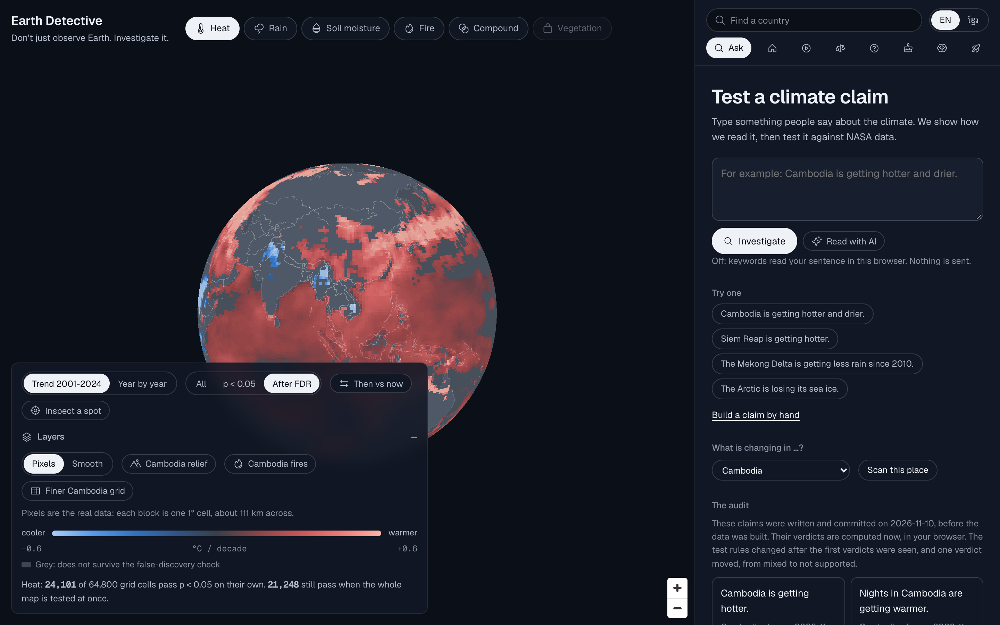 | **Ask.** The claim box, the AI switch (off), example chips, and the audit strip of frozen claims. |
| 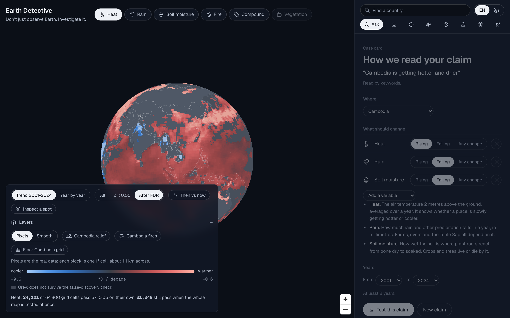 | **Claim card.** "Cambodia is getting hotter and drier", read by keywords into a region and three tests. Each test can be edited. |
| 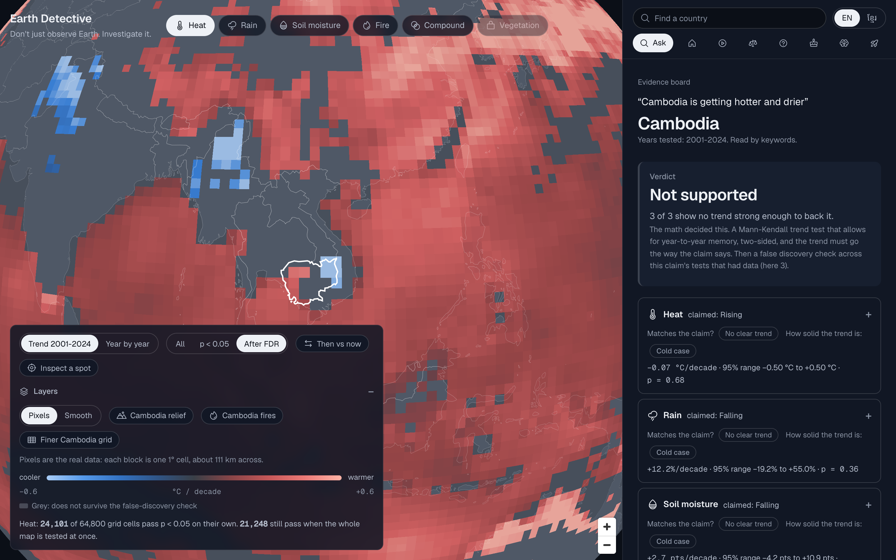 | **Evidence board.** The verdict ("Not supported") and one row per test, with the trend per decade, the 95% range, and p. |
| 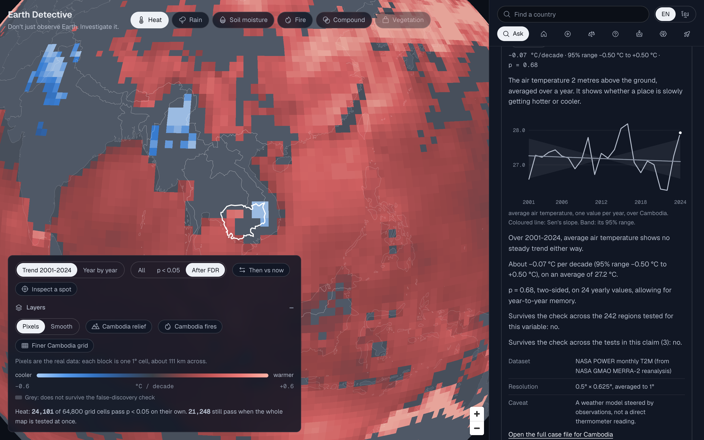 | **An open evidence row.** The chart, the what, how much, and how sure lines, and the sources. |
| 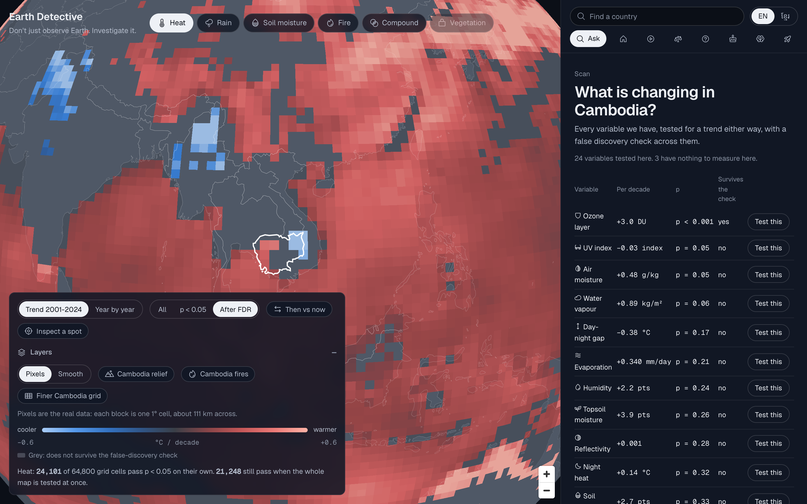 | **Scan.** Every variable for Cambodia, sorted by p, with the false-discovery check and a "Test this" button. |
| 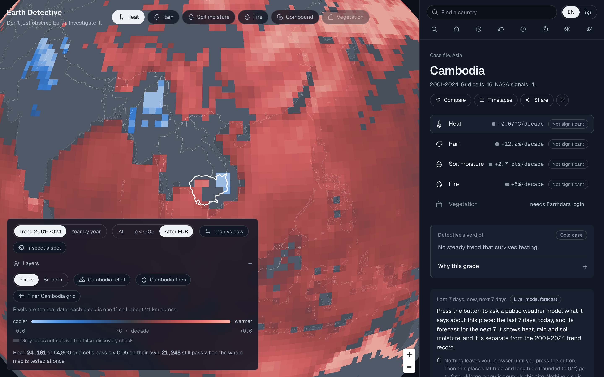 | **Case file.** The original four-question case file for Cambodia's heat. |
| 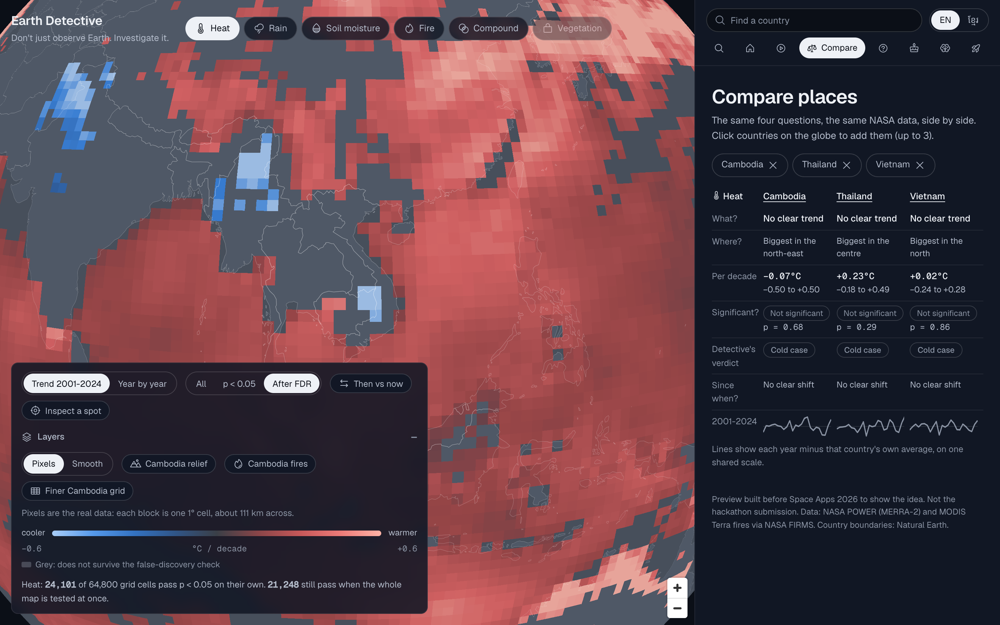 | **Compare.** Up to three countries side by side. |
| 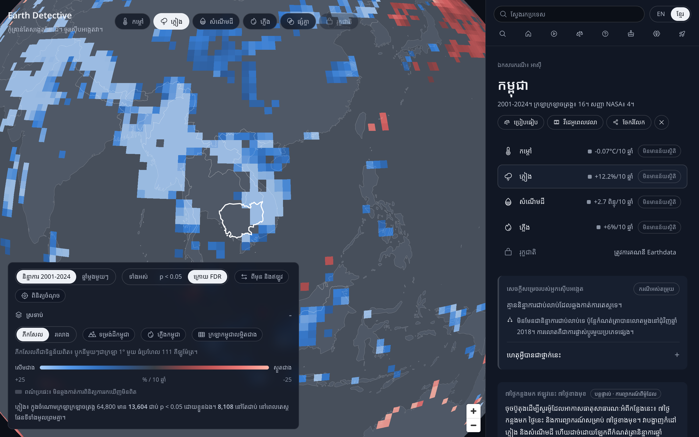 | **Khmer.** The case file for rain, in Khmer. |
| 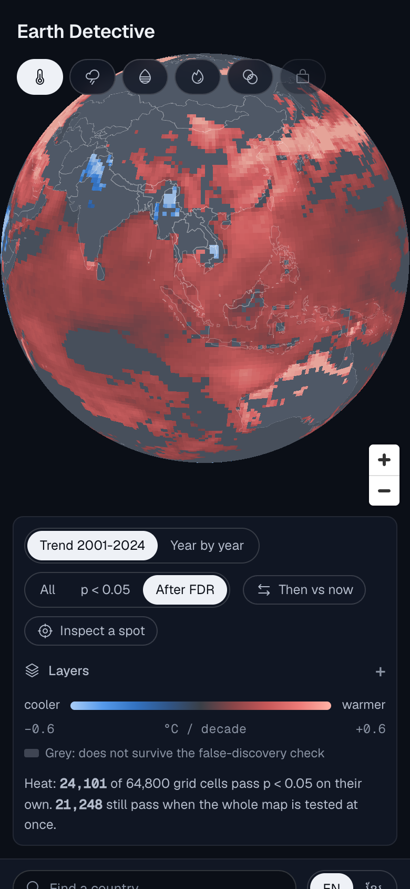 | **Phone.** The ask view at phone width. |

## Earth Buddy analyst

The analyst is a light app built around a question box. A sidebar on the left lists topics and the "second brain".

| Screen | What it shows |
|---|---|
|  | **Ask.** The question box and the topic sidebar. |
|  | **Trend answer.** "How is temperature changing in Phnom Penh?": the headline, the plain-language text, and the "about the data" note. |
| 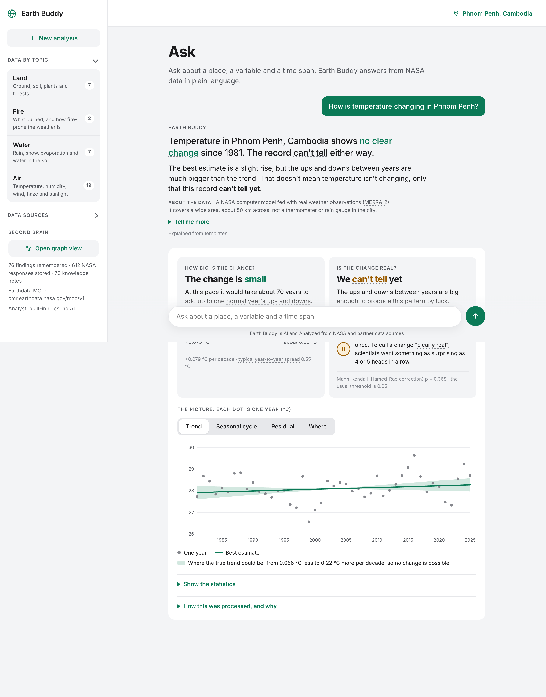 | **The full answer.** The size and certainty cards (including the coin analogy), the charts, the method, and the sources. |
|  | **Trend tab.** The trend part of the STL split. |
|  | **Seasonal cycle tab.** |
|  | **Residual tab.** |
|  | **Where tab.** The trend in each grid cell around Phnom Penh. |
| 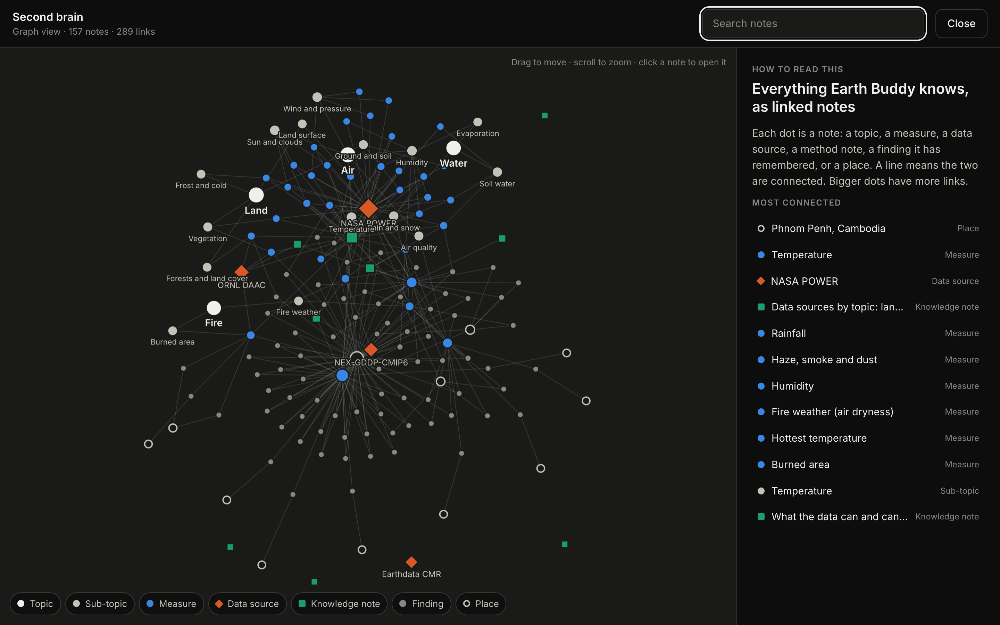 | **Second brain.** The graph of topics, measures, sources, notes, findings, and places. The new spec cuts this screen. |
| 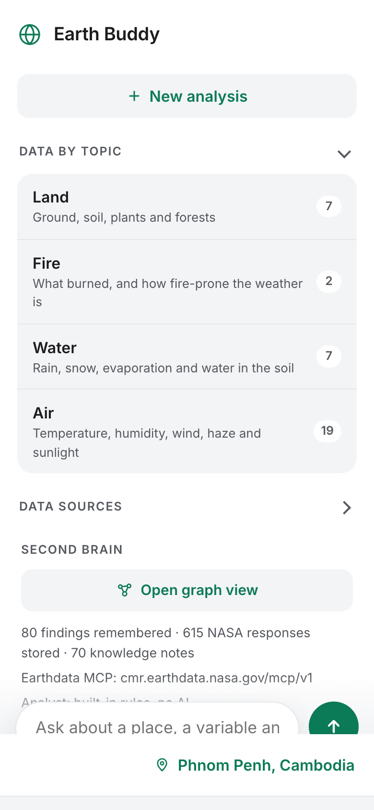 | **Phone.** The ask view at phone width. |

## Differences from the new spec

- **Map tiles.** The analyst's Where map uses OpenStreetMap tiles. The new spec allows only NASA GIBS imagery (`docs/16-data-sources.md`).
- **Fonts.** The analyst loads Inter from Google Fonts. The new spec vendors its fonts.
- **Cut screens.** The second-brain graph, the globe's year-by-year and "then vs now" modes, and the compare page are not in the new spec (`SPEC.md`, "Not building").
- **Missing screens.** There are no shots of the analyst's rank and relate answers. Neither rendered within 3 minutes during capture.
