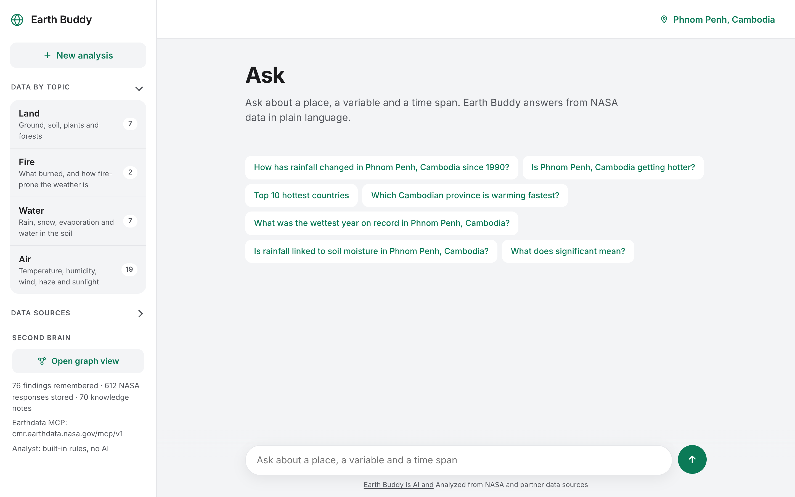
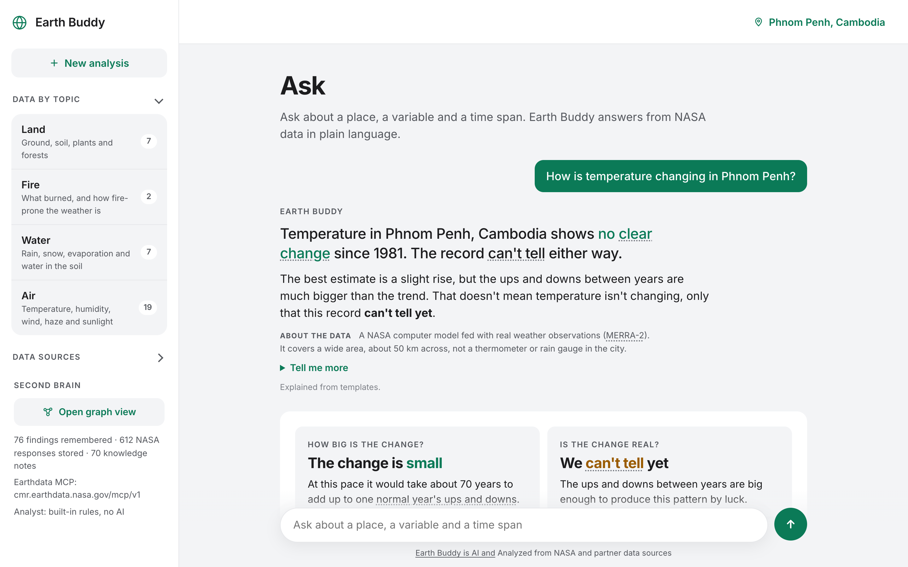
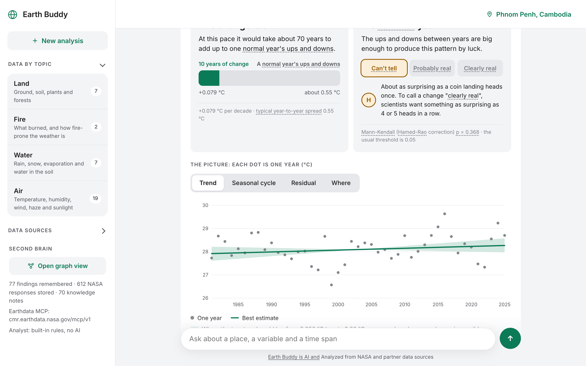
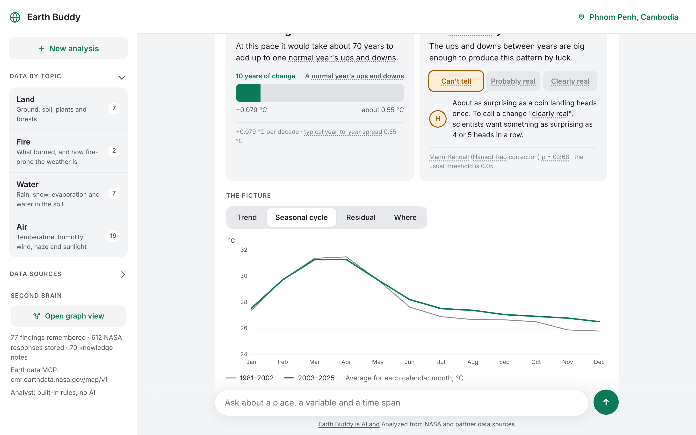
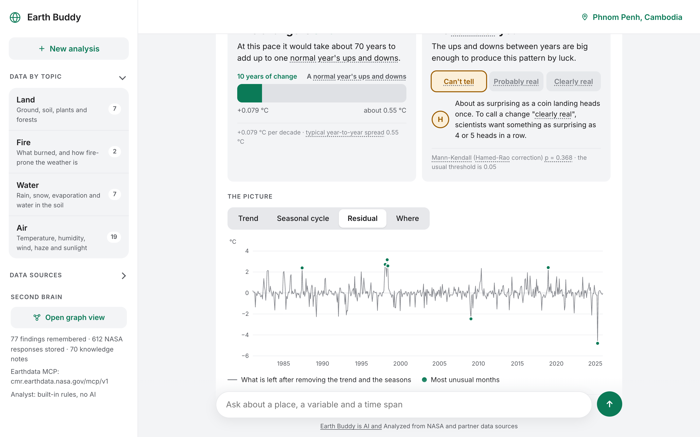
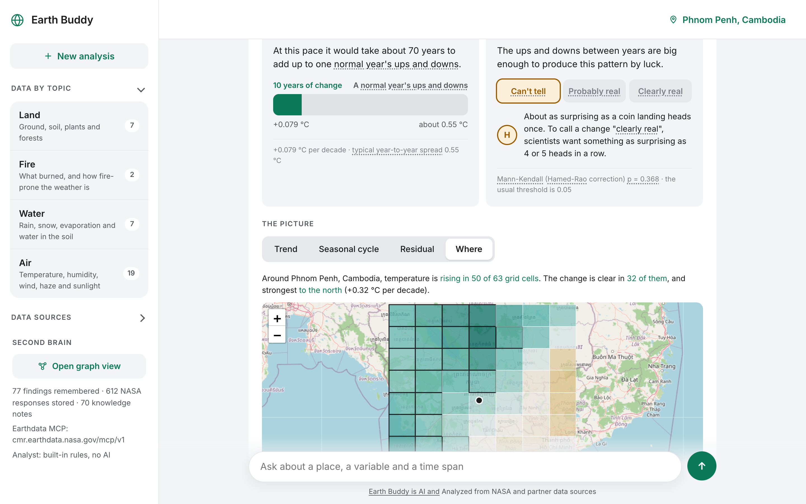

# Screenshots of the Earth Buddy analyst prototype

These screens show the existing visual design of the Earth Buddy analyst prototype. They are a reference for `docs/14-web-ui.md`. The new app takes its behaviour from the spec, not from these screens. Where a screen and the spec differ, the spec wins.

All screens were captured on 14 Nov 2026 with Playwright in Chrome at 1440 × 900 (phone shot at 390 × 844), at 2× pixel density. The app ran on real NASA data with AI off (`EARTH_BUDDY_ANALYST=rules`), so its text comes from templates.

The analyst is a light app built around a question box. A sidebar on the left lists topics and the "second brain".

| Screen | What it shows |
|---|---|
|  | **Ask.** The question box and the topic sidebar. |
|  | **Trend answer.** "How is temperature changing in Phnom Penh?": the headline, the plain-language text, and the "about the data" note. |
|  | **The full answer.** The size and certainty cards (including the coin analogy), the charts, the method, and the sources. |
|  | **Trend tab.** The trend part of the STL split. |
|  | **Seasonal cycle tab.** |
|  | **Residual tab.** |
|  | **Where tab.** The trend in each grid cell around Phnom Penh. |
|  | **Second brain.** The graph of topics, measures, sources, notes, findings, and places. The new spec cuts this screen. |
|  | **Phone.** The ask view at phone width. |

## Differences from the new spec

- **Map tiles.** The Where map uses OpenStreetMap tiles. The new spec allows only NASA GIBS imagery (`docs/16-data-sources.md`).
- **Fonts.** The app loads Inter from Google Fonts. The new spec vendors its fonts.
- **Cut screens.** The second-brain graph is not in the new spec (`SPEC.md`, "Not building").
- **Missing screens.** There are no shots of the rank and relate answers. Neither rendered within 3 minutes during capture.
